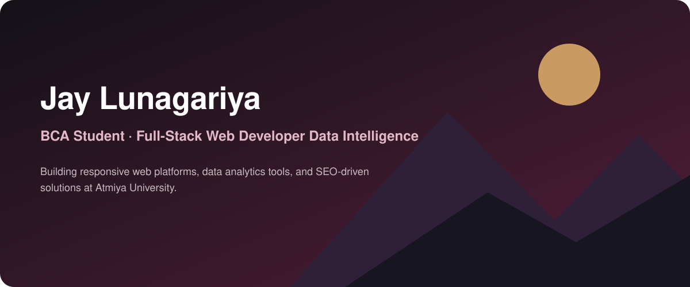

<!-- Hero Section -->

  
  
  <h1>Hi, I'm Lunagariya Jay 👋</h1>
  <h3>Data Intelligence | Full-Stack Web Developer | Founder at Sian Architects</h3>

---

## 🚀 About Me

I am a 3rd-year Bachelor of Computer Applications (BCA) student at Atmiya University with a strong focus on data intelligence and full-stack web development. I actively build web platforms, integrate AI/ML models, and lead campus community initiatives.

- 🏢 **Currently working on:** Data Intelligence at Alphabit Infoway Pvt. Ltd.
- 🏗️ **Founder & Lead Developer:** Designed, built, and deployed the full-stack web portal for Sian Architects.
- 🎓 **Education:** Atmiya University (BCA, 2024–2027)
- 🤝 **Community Leadership:** Internshala Student Partner representing Atmiya University & former Official College Ambassador for Techfest (IIT Bombay).
- 📫 **How to reach me:** [તમારું ઈમેલ આઈડી અથવા લિંક્ડઈન લિંક અહી મૂકો]

---

## 💻 Tech Stack

**Languages & Frameworks**
`PHP` `Python` `C#` `JavaScript` `HTML5` `CSS3` `Laravel` `Tailwind CSS` `Bootstrap`

**AI, Machine Learning & Data Science**
`TensorFlow` `Keras` `Scikit-learn` `Pandas` `NumPy`

**Databases & Tools**
`MySQL` `Git` `Figma (UI/UX)` `XAMPP` `Google Search Console`

---

## 📈 GitHub Activity

  

